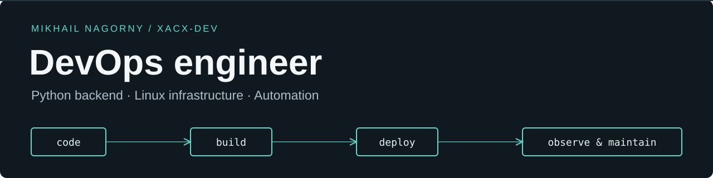

[English](README.md) · [Русский](README.ru.md) · [Public repositories](https://github.com/xacx-dev?tab=repositories&type=public)

# Hi, I'm Mikhail

**Python developer & DevOps engineer.** I build APIs, bots and web applications, and work on the infrastructure that runs them.

My experience spans Django/FastAPI services, background workers, databases and integrations, alongside Linux administration, containerization, CI/CD and monitoring. I moved into a dedicated System Administrator / DevOps role in February 2026, building on my software development work.

## What I work on

- **Python development:** REST APIs with Django/DRF and FastAPI, Telegram bots, business applications, database integrations, async services and background jobs.
- **Web applications & data:** Vue interfaces, third-party APIs, browser automation, spreadsheet processing and data pipelines.
- **Deployment & automation:** Docker and Compose environments, Ansible server provisioning and updates, GitHub Actions workflows, scripted releases and rollback procedures.
- **Linux operations:** Ubuntu, Debian and Astra Linux; systemd services and timers, SSH, backups, log rotation, health checks and service migration between VPS hosts.
- **Monitoring & troubleshooting:** Zabbix agents and proxies, Grafana, filesystem and inode monitoring, journald, database and network diagnostics.
- **Networking & virtualization:** Nginx, Caddy, HAProxy, HTTPS, DNS, IPv4/IPv6 and WireGuard; Hyper-V virtual machines and UEFI/GRUB recovery.

## Technology stack

| Area | Tools I use |
| :--- | :--- |
| Python backend | Django · Django REST Framework · aDRF · FastAPI · Pydantic · SQLAlchemy · Alembic · Tortoise ORM |
| Data & background jobs | PostgreSQL · MySQL · SQLite · Redis · RabbitMQ · Celery · APScheduler |
| Web & integrations | Vue 3 · TypeScript · JavaScript · Vite · HTML/CSS · aiogram · Telethon · Playwright |
| Infrastructure & delivery | Linux · Docker · Docker Compose · Ansible · GitHub Actions · Git · Bash · PowerShell |
| Monitoring & networking | Zabbix · Grafana · systemd · Nginx · Caddy · HAProxy · WireGuard · Hyper-V |
| Quality & checks | pytest · Ruff · Vitest · ESLint · OpenAPI validation · Gitleaks |

More from my projects: data processing, automation and embedded Linux

- **Data processing:** pandas, NumPy, DuckDB, PyArrow/Parquet, openpyxl and XlsxWriter.
- **Async services & collection:** asyncio, aiohttp, HTTPX, Requests, Selenium and Beautiful Soup.
- **ML components:** scikit-learn; acoustic data processing and classification components in Python projects.
- **Embedded Linux:** Raspberry Pi, GPIO, I²C, UART/serial, Weston/Wayland, DRM/KMS and kiosk interfaces.
- **Application runtime:** Uvicorn, Gunicorn, WebSockets, REST APIs and third-party API integrations.

## Selected project experience

These summaries cover projects with private code. They describe the engineering work without exposing internal systems or customer data.

| Project | Application & engineering work | Main technologies |
| :--- | :--- | :--- |
| **Vacancy data platform** | Collection API, browser automation, Telegram ingestion, separate workers and scheduler; containerized deployment, HTTPS and backups. | FastAPI · SQLAlchemy · PostgreSQL · Redis · Playwright · Telethon · Docker |
| **Marketplace operations platform** | Backend and web application for operational workflows and analytics; multi-service deployment, migrations, background workers, CI checks and release/rollback scripts. | Django/DRF · Vue 3 · TypeScript · PostgreSQL · Docker Compose · GitHub Actions |
| **Learning & assessment platform** | Roles, learning programs, assessments and document generation; containerized deployment, queues, HTTPS and scheduled database backups. | Django/DRF · Vue 3 · Celery · Redis · PostgreSQL · Docker Compose |
| **Telegram loyalty Mini App** | Customer application, separate administration interface and API; frontend/backend builds, automated checks and container health checks. | Django/aDRF · Vue 3 · TypeScript · PostgreSQL · Docker · GitHub Actions |
| **Raspberry Pi device platform** | Displays, sensors, audio and a Linux kiosk UI; systemd services, Git-based updates, health checks, backups and rollback. | Python · FastAPI · PostgreSQL · Raspberry Pi · systemd · Wayland |
| **Business bots & administration** | Telegram bots with Django administration, scheduled tasks, external API integrations, spreadsheet processing and containerized services. | aiogram · Django · APScheduler · PostgreSQL · Redis · Docker Compose |

## Public code

**[MaxBot_template](https://github.com/xacx-dev/MaxBot_template)** — a MAX bot starter with a separate API, database migrations and a three-service Compose setup. Includes Dockerfiles, a backup script and log limits.  
`Python` · `FastAPI` · `SQLAlchemy` · `Alembic` · `PostgreSQL` · `Docker Compose`

Earlier projects and experiments

| Repository | What it contains |
| :--- | :--- |
| [BotTelegramProject](https://github.com/xacx-dev/BotTelegramProject) | A community Telegram bot: registration, profiles, member search and API integration. Python, aiogram and Requests. |
| [BotAssistant](https://github.com/xacx-dev/BotAssistant) | Chat-group administration and broadcasts, including XLSX imports. Python, aiogram, Requests and openpyxl. |
| [HackathonKM](https://github.com/xacx-dev/HackathonKM) | A hackathon bot with registration, profiles, learning questions and feedback through an API. Python and aiogram. |
| [python-database-easy-and-fast](https://github.com/xacx-dev/python-database-easy-and-fast) | An experimental file-backed database with a TCP server and Python client. |
| [vezdecode](https://github.com/xacx-dev/vezdecode) | An early VK API project for exploring connections between conversation participants. |
| [minecraft-enrichment-uranium-cell](https://github.com/xacx-dev/minecraft-enrichment-uranium-cell) | An early Minecraft / RedPower 2 automation experiment. |

These repositories document earlier work and experiments; their dependencies and APIs reflect the time they were written.

## Professional background

- **ElRos · October 2024–present.** Joined as a lead application software engineer working on Django APIs, microservices and deployments. Transferred to **System Administrator / DevOps in February 2026**, focusing on infrastructure, CI/CD, Ansible and monitoring.
- **BOTTEC · May 2022–June 2024.** Middle Python developer: business Telegram bots, Django administration, API integrations and deployment on Linux with Docker and Nginx.
- **CHATEX · October–November 2021.** Frontend internship: Vue.js, React, JavaScript and SDK/API work.
- **Haclever · October 2019–May 2020.** Junior Python developer: aiogram bots, FastAPI services, async programming and Ubuntu/Docker environments.

## Education & interests

**Vladimir State University** — bachelor's degree in Infocommunication Technologies and Communication Systems, **2025**. Master's studies in Radio Engineering and Radio Systems, **expected 2027**.

Outside software, I enjoy radio engineering, microcontrollers and working on cars. Raspberry Pi projects bring my software and electronics interests together.

---

**Get in touch:** [Telegram for work](https://t.me/the_xacx_work) · [GitHub](https://github.com/xacx-dev)
